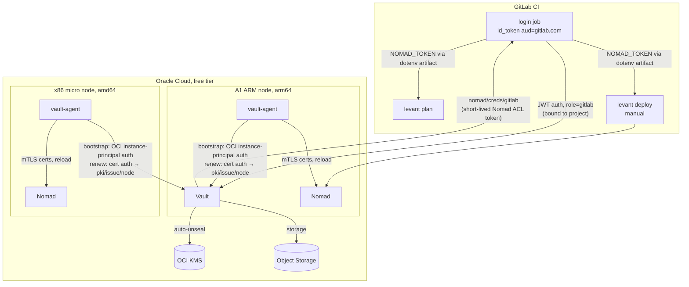

# oci-nomad-vault

A small HashiCorp platform on Oracle Cloud's free tier, built to host a
Matrix homeserver (Synapse, Element, coturn, and bridges to Signal, IRC and
Slack). There are no long-lived secrets anywhere: CI authenticates with OIDC,
nodes with cloud instance identity, services with short-lived Vault-issued
credentials, and Vault itself unseals through the cloud KMS.

> **Status: never went to production (2023).** The platform pieces worked.
> The Matrix workload stalled on two-way service discovery between the
> homeserver and its bridges across nodes of different CPU architectures. See
> [Why the Matrix workload never shipped](#why-the-matrix-workload-never-shipped).
> This is a sanitised snapshot of a private repository with squashed history
> (162 commits, Apr–Aug 2023).

## Architecture



### Identity and secrets

- **CI holds no Vault or Nomad credentials.** `.gitlab-ci.yml` requests a
  GitLab `id_token`, and `nomad_login.py` exchanges it at Vault's JWT auth
  backend (`setup/vault/auth/jwt/roles/gitlab.json`, bound to the project ID
  and audience). The Vault token can only read `nomad/creds/gitlab`: Vault's
  Nomad secrets engine mints a short-lived Nomad ACL token, scoped by
  `setup/nomad/policies/gitlab.hcl`. That token is passed to the `plan` and
  `deploy` jobs as a dotenv artifact.
- **Nodes authenticate with their cloud identity.** Each VM bootstraps with
  OCI instance-principal auth (`auth/oci/roles/node.json`, with an OCID
  allow-list and a 30-minute TTL), so no credential is baked into the image.
  After that, vault-agent renews with cert auth using its current node
  certificate. It renders a fresh certificate from Vault PKI into `/etc/ssl`
  and reloads Vault and Nomad, so all Vault and Nomad traffic is mutual TLS
  from an internal CA.
- **Services get dynamic credentials.**
  - Each Matrix component gets its own short-lived Postgres login from
    Vault's database engine (`database/creds/synapse`, `…/irc`, `…/signal`,
    `…/slack`).
  - Static secrets (appservice `as_token`/`hs_token`, macaroon and form
    secrets, the TURN shared secret, the Slack app credentials) come from Vault
    KV.
  - All of these are rendered into config by Nomad `template` blocks at
    runtime. No config file in this repo contains a secret.
- **Vault needs no unseal ceremony.** It uses the OCI Object Storage backend,
  and the `ocikms` seal unseals it automatically through OCI KMS
  (`setup/vault/vault.hcl`).
- **The CA rotates with overlap.** The procedure is in
  `notes/ca-rotation.md`: issue a new root under a new issuer name, trust
  both, switch the default, then retire the old one. `setup/vault/scripts/rotate`
  automates it with a 2-month validity, logging in as a dedicated OCI role
  `ca` whose token lasts 5 minutes and may only call the two rotate and
  replace endpoints.
- **Least privilege throughout.** Separate Vault policies cover `admin`,
  `node`, `nomad`, `ca` and `gitlab`, and Nomad ACL policies cover each
  consumer (`gitlab`, `traefik`).

### Workload

`matrix.nomad` is a [Levant](https://github.com/hashicorp/levant) template with
one Nomad job. Each component is its own group, pinned by CPU architecture:

| Group | Image | Arch |
|---|---|---|
| traefik (ingress, Let's Encrypt) | traefik 2.10 | arm64 |
| nginx (`.well-known`, static) | nginx 1.24 | arm64 |
| database | postgres 15 | arm64 |
| coturn (TURN for VoIP) | coturn 4.6 | arm64 |
| synapse | synapse 1.86 | arm64 |
| signal (signald + mautrix-signal) | signald, mautrix-signal | arm64 |
| element (web client) | element-web 1.11 | arm64 |
| irc | matrix-appservice-irc | **amd64** |
| slack | mx-puppet-slack | **amd64** |

OCI's free A1 ARM allowance is generous, so nearly everything
runs there. The IRC and Slack bridges had no arm64 images, so they had to go
on the small x86 VM. Discovery uses Nomad's built-in service registry
(`provider = "nomad"`), with no Consul.

## Why the Matrix workload never shipped

Matrix bridges (appservices) need **HTTP in both directions** with the
homeserver:

- **Synapse → bridge:** Synapse pushes events to each bridge at the `url`
  in that bridge's registration file.
- **Bridge → Synapse:** each bridge calls the client-server API at its
  configured homeserver address.

On Nomad's built-in discovery, each side was rendered from the other's
service registration:

```hcl
# config/synapse/appservice-irc-registration.yaml (rendered into the synapse task)
url: http://{{ range nomadService "matrix-irc-appservice-irc" }}{{ .Address }}:{{ .Port }}{{ end }}
```

- **Synapse waited on the bridges.** Templates block a task from starting
  until their data resolves, so Synapse couldn't start until every bridge had
  registered.
- **The bridges needed Synapse running.** They need the homeserver up (and
  the registration loaded) before they're useful. In practice that made the
  start-up order circular, and every restart of either side changed ports and
  re-rendered the other.
- **The workaround was partial.** I pinned Synapse to a static port and
  pointed the bridges at a fixed node address
  (`homeserver.url: http://10.0.0.44:8008`). That's fragile, and it only fixed
  one direction.
- **The obvious fix was ruled out.** Putting Synapse and the bridges in one
  group would share a network namespace and let them talk over `localhost`.
  It wasn't possible, because the amd64-only bridges had to run on a
  different node from Synapse.

Ways out I'd weigh today:

1. **Route both directions through the ingress.** Give Synapse and each bridge
   a stable internal hostname on Traefik, which already discovers services
   dynamically. Registrations and bridge configs then contain fixed URLs, the
   template dependency disappears, and placement no longer matters. This is
   the smallest change.
2. **Use a service mesh.** Consul with Connect sidecars gives each task a fixed
   local upstream port for the other side, on any node. It's a heavier
   footprint, but it's the general solution.
3. **Remove the architecture split.** Build arm64 images of the two bridges,
   or replace them, then run Synapse and its bridges in a single group.

## Layout

| Path | Purpose |
|---|---|
| `matrix.nomad` | Levant/Nomad job for the whole Matrix stack |
| `config/` | Templated configs for each service, rendered by Nomad from Vault |
| `.gitlab-ci.yml`, `nomad_login.py` | OIDC → Vault → Nomad token exchange, plan and deploy |
| `setup/vault/` | Vault server config, auth roles (JWT, OCI, token), policies, rotation scripts |
| `setup/vault-agent/` | Per-node agent: cert auth, PKI templates, reload hooks |
| `setup/nomad/policies/` | Nomad ACL policies |
| `notes/` | Install notes and the CA rotation procedure |
| `module.tf` | OCI provider scaffolding. The module was never written; the VMs, block volume, KMS and bucket were built by hand following `notes/install.md` |

## Known gaps

- **Single Vault node:** HA is disabled on the Object Storage backend.
- **CA rotation isn't scheduled.** The script exists, but no Nomad periodic
  job or timer runs it.
- **Terraform is a stub** (see above).

### Hardening added for publication

- **Traefik dashboard:** it's unauthenticated, but was routed publicly. It's
  now restricted to the private network by the `internal` IP allow-list,
  which was already defined but never attached. Vault and Nomad stay
  publicly routed because GitLab's hosted runners have to reach them; both
  enforce their own token authentication and ACLs.
- **GitLab JWT role:** it was bound only to the project ID, so any branch's
  pipeline could get a Nomad token. It now also requires a protected branch
  (`ref_type: branch`, `ref_protected: true`).
- **Nomad `gitlab` policy:** it could mount any host volume. It's now
  limited to the three the job uses (`postgresql`, `synapse`, `signal`).

## Sanitisation

Squashed history.
- **Domains and people:** domains became `example.com`, and Matrix user IDs
  and a third-party IRC network were replaced.
- **Cloud and GitLab identifiers:** the OCI KMS key, vault, Object Storage
  namespace and GitLab project ID are placeholders.
- **The one hard-coded secret** in the original tree (Slack app OAuth
  credentials in the mx-puppet-slack config) is now templated from Vault, like
  everything else.
